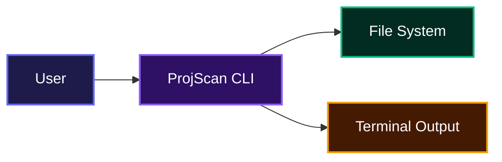

# ProjScan

A developer's pocket companion for quickly understanding what's inside any project directory. ProjScan scans folders, breaks down file types by extension, counts lines of code, and flags React components that have grown a little too large. No configuration, no fuss, just actionable insight straight from the command line.

## System Design



## Installation

You can get ProjScan on your machine in a few different ways.

### Install with npm

```bash
npm install -g projscan-cli
```

Once installed, the projscan command is globally available:

### Pre-built binaries

Head over to the [Releases](https://github.com/abubakar-sadiq001/projscan/releases) page and grab the archive for your OS and architecture. Extract it and run the `projscan` binary.

### Install with Go

```bash
go install github.com/abubakar-sadiq001/projscan@latest
```

### Build from source

1. Clone the repository:

```bash
git clone https://github.com/abubakar-sadiq001/projscan.git
```

2. Navigate into the project folder:

```bash
cd projscan
```

3. Build the binary (or install globally with `go install`):

```bash
go build -o projscan .
```

Now you can run ProjScan from the terminal.

## Usage

The most common way to use ProjScan is to point it at a directory and let it do its thing.

```bash
projscan /path/to/your/project
```

When you're inside the project directory, a simple dot does the trick:

```bash
projscan .
```

### Filtering by extension

Want to focus only on certain file types? Pass the `-e` flag with a comma-separated list.

```bash
projscan . -e .go,.tsx
```

### Checking version

Print the version, commit hash, and build date of your installed binary.

```bash
projscan version
```

Or use the shorthand flag:

```bash
projscan -v
```

Example output:

```
ProjScan v0.1.0
Commit: a1b2c3d
Built: 2026-01-15T10:30:00Z
```

### Sample output

ProjScan prints a summary that includes:

- Total file counts by extension
- File sizes and line counts
- A list of all files found, ordered by extension, with their individual line counts
- A special section that calls out React components that exceed 300 lines, helping you spot oversized components before they hurt maintainability.

The scan shows an animated spinner while it works, so you know something is happening even on larger projects.

## Features

- **Recursive directory scanning** – walks through every subdirectory automatically

  ```mermaid
  sequenceDiagram
    actor User
    participant ProjScanCLI as "ProjScan CLI"
    participant FileSystem

    User->>ProjScanCLI: projscan ./my-project
    ProjScanCLI->>ProjScanCLI: Validate directory path
    ProjScanCLI->>FileSystem: Walk directory tree
    FileSystem->>ProjScanCLI: Return file entries
    ProjScanCLI->>ProjScanCLI: Count lines, group by extension, detect large components
    ProjScanCLI->>User: Print file summary, component warnings, and stats
  ```

- **Extension‑based grouping** – groups files by extension (.js, .tsx, .go, etc.) for a clear overview
- **Per‑file line counts** – shows exactly how many lines of code each file contains
- **Component detection** – recognizes files that start with an uppercase letter and have a JS‑like extension, treating them as React components
- **Large component warnings** – highlights any component with more than 300 lines, so you can refactor before technical debt piles up
- **Extension filtering** – scope the scan to only the file types you care about with a simple CLI flag
- **Human‑readable size formatting** – automatically displays sizes in bytes, KB, MB, or GB depending on the magnitude
- **Live scanning spinner** – provides real‑time feedback without clutter
- **Built‑in version information** – check which release you're running with `projscan version` or the `-v` flag

## Technologies Used

| Technology                                               | Description                                                                                                     |
| -------------------------------------------------------- | --------------------------------------------------------------------------------------------------------------- |
| [Go](https://go.dev/)                                    | Core language                                                                                                   |
| [Cobra](https://github.com/spf13/cobra)                  | CLI framework that handles command parsing and help text                                                        |
| [progressbar](https://github.com/schollz/progressbar/v3) | Library used for the spinner animation (dependency exists but not directly invoked; custom spinner implemented) |

## Author

**Abubakar Sadiq**

- X (Twitter): [@scripter_js](https://x.com/scripter_js)

## Badges

[](https://go.dev/)

[](https://dokugen.samueltuoyo.com)

```

```
